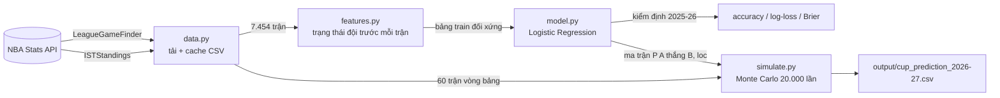

<div align="center">

# 🏀 NBA Cup Predictor

**Dự đoán đội vô địch Emirates NBA Cup 2026-27 bằng Logistic Regression đối xứng và mô phỏng Monte Carlo toàn bộ giải**


</div>

## TL;DR

- **Bài toán:** mỗi mùa NBA Cup chỉ có **một** nhà vô địch, nên không thể học trực tiếp "đội nào vô địch".
- **Cách làm:** học **xác suất thắng của từng trận** từ 7.454 trận (2020-21 → nay), rồi mô phỏng phần còn lại của giải 20.000 lần theo đúng thể thức và luật tiebreak.
- **Kết quả:** trên mùa 2025-26 (1.225 trận, không dùng khi train), accuracy **0.688** so với **0.554** của baseline "chủ nhà luôn thắng"; log-loss 0.597; Brier 0.205.

```text
$ python predict.py
   Test 2025-26 (1225 trận): accuracy=0.688 | log-loss=0.597 | brier=0.205 | baseline 'chủ nhà luôn thắng'=0.554
   Vòng bảng: 37 trận đã đá, 23 trận còn lại
=> Ứng viên số 1: BOS (25.0% vô địch)
```

---

## 1. Problem Statement & Motivation

NBA Cup là giải đấu diễn ra trong mùa giải chính thức: 30 đội chia 6 bảng, sau vòng bảng còn 8 đội đá loại trực tiếp. Câu hỏi: **trước và trong vòng bảng, mỗi đội có bao nhiêu phần trăm khả năng vô địch?**

- **Input:** kết quả mọi trận mùa giải chính thức từ 2020-21, bảng xếp hạng và lịch vòng bảng NBA Cup hiện tại.
- **Output:** với mỗi đội, xác suất nhất bảng, vào tứ kết, vào bán kết, vào chung kết và vô địch.
- **Vì sao khó:**
  - Mỗi năm chỉ có 1 nhãn "vô địch", quá ít để học trực tiếp.
  - Kết quả phụ thuộc vào luật tiebreak (đối đầu, hiệu số) và nhánh đấu, không chỉ vào sức mạnh từng đội.
  - Đầu mùa, mỗi đội mới đá vài trận nên chỉ số rất nhiễu.
- **Mục tiêu đo được:** mô hình từng trận phải vượt baseline "chủ nhà luôn thắng" trên một mùa chưa thấy, và xác suất dự đoán phải được hiệu chỉnh tốt (log-loss, Brier thấp), vì mô phỏng dùng trực tiếp các xác suất này.

## 2. System Architecture



| Module | Trách nhiệm | File |
|---|---|---|
| Data | Gọi NBA Stats API, gộp 2 dòng đội thành 1 dòng trận, cache CSV, lấy 60 trận vòng bảng | [`nbacup/data.py`](nbacup/data.py) |
| Features | Tính trạng thái mỗi đội **ngay trước** mỗi trận, co về mùa trước, tạo bảng train đối xứng | [`nbacup/features.py`](nbacup/features.py) |
| Model | Huấn luyện, kiểm định theo thời gian, tính ma trận xác suất cho mọi cặp đội | [`nbacup/model.py`](nbacup/model.py) |
| Simulation | Mô phỏng vòng bảng còn lại, xếp hạng theo tiebreak, mô phỏng tứ kết → chung kết | [`nbacup/simulate.py`](nbacup/simulate.py) |
| Pipeline | Chạy toàn bộ 4 bước và in kết quả | [`predict.py`](predict.py) |

**Quyết định thiết kế chính:** tách "mô hình một trận" khỏi "mô phỏng giải". Mô hình chỉ cần trả lời `P(A thắng B | sân)`, còn toàn bộ luật NBA Cup nằm trong `simulate.py`. Nhờ vậy có thể thay mô hình (ví dụ Elo) mà không đụng vào phần mô phỏng.

## 3. Methodology

### 3.1 Feature

Mỗi trận được mô tả bằng **hiệu số** chỉ số của đội A và đội B:

| Feature | Ý nghĩa |
|---|---|
| `d_margin` | Chênh lệch hiệu số điểm trung bình mỗi trận |
| `d_winpct` | Chênh lệch tỉ lệ thắng |
| `d_last10` | Chênh lệch hiệu số điểm trung bình 10 trận gần nhất (phong độ) |
| `d_rest` | Chênh lệch số ngày nghỉ (cắt ở 4 ngày) |
| `LOC` | `1` = A đá sân nhà, `0` = sân trung lập (Las Vegas), `-1` = A đá sân khách |

### 3.2 Co chỉ số về mùa trước (shrinkage)

Sau 1–2 trận, tỉ lệ thắng của một đội gần như vô nghĩa. Chỉ số mùa hiện tại vì vậy được trộn với chỉ số mùa trước theo số trận đã đá $n$:

$$
\text{blended} = \frac{n \cdot \text{mùa này} + K \cdot \text{mùa trước}}{n + K}, \qquad K = 12
$$

Sau khoảng 12 trận, hai nguồn có trọng số bằng nhau. Chỉ số mùa trước cũng được kéo 30% về mức trung bình giải (nhân 0.7), vì đội hình thay đổi giữa các mùa.

### 3.3 Mô hình đối xứng

- `StandardScaler(with_mean=False)` + `LogisticRegression(fit_intercept=False, C=1.0)`.
- Mỗi trận được đưa vào **hai lần**: góc nhìn chủ nhà (feature $x$, nhãn $y$) và góc nhìn đội khách (feature $-x$, nhãn $1-y$).
- Không có intercept và không trừ trung bình, nên mô hình đối xứng theo cấu trúc:

$$
P(A \text{ thắng } B) = \sigma(w^\top x_{AB}) = 1 - \sigma(w^\top x_{BA}) = 1 - P(B \text{ thắng } A)
$$

Với `LOC = 0`, mô hình cho được xác suất của trận sân trung lập dù dữ liệu train gần như không có trận nào như vậy.

### 3.4 Mô phỏng Monte Carlo

- **Thể thức:** 6 bảng × 5 đội. Mỗi miền có 3 đội nhất bảng (hạt giống 1–3) và 1 wild card (hạt giống 4) vào tứ kết. Tứ kết đá 1 vs 4 và 2 vs 3 trên sân của hạt giống cao hơn; bán kết và chung kết đá sân trung lập.
- **Xếp hạng bảng:** số trận thắng → đối đầu → hiệu số → ngẫu nhiên.
- **Cách biệt điểm:** tiebreak cần hiệu số, nên mỗi trận vòng bảng được lấy mẫu cách biệt $m \sim \mathcal{N}(\mu, 12.5^2)$, với $\mu = 12.5 \cdot \Phi^{-1}(p)$ để $P(m \gt 0)$ đúng bằng xác suất $p$ của mô hình.
- Trận đã đá dùng kết quả thật; mỗi lần chạy dùng `seed = 42` nên kết quả tái lập được.

## 4. Dataset & Preprocessing

| | |
|---|---|
| **Nguồn** | NBA Stats API qua thư viện [`nba_api`](https://github.com/swar/nba_api): `LeagueGameFinder` (kết quả trận), `ISTStandings` (bảng và lịch NBA Cup) |
| **Kích thước** | 7.454 trận mùa giải chính thức, 7 mùa (2020-21 → 2026-27, tính đến 22/11/2026) |
| **Chia tập** | Theo thời gian. Train 2021-22 → 2024-25, test 2025-26. Mùa 2020-21 chỉ dùng làm "mùa trước" cho 2021-22 |
| **Phân phối nhãn** | Chủ nhà thắng 55.4% số trận ở mùa test; bảng train cân bằng 50/50 nhờ nhân đôi đối xứng |

**Tiền xử lý:**
1. Gộp 2 dòng (chủ nhà, khách) của mỗi trận thành 1 dòng dựa trên chuỗi `MATCHUP` (`vs.` / `@`), bỏ trận chưa có kết quả.
2. Chuyển sang dạng "mỗi đội mỗi trận", sắp theo ngày.
3. **Chống rò rỉ dữ liệu:** mọi chỉ số tích luỹ đều dùng `shift()` trước khi tính trung bình, nên feature của một trận chỉ chứa thông tin từ các trận **trước** nó.
4. Co chỉ số về mùa trước (mục 3.2); mùa đầu tiên không có mùa trước nên bị loại khỏi bảng train.

## 5. Experiments & Evaluation

- **Metrics:**
  - *Accuracy:* tỉ lệ đoán đúng đội thắng.
  - *Log-loss* và *Brier score:* đo chất lượng xác suất. Đây là hai metric quan trọng nhất, vì mô phỏng dùng trực tiếp xác suất chứ không dùng nhãn thắng/thua.
- **Baseline:** "chủ nhà luôn thắng", một quy tắc đơn giản nhưng khó vượt trong thể thao.
- **Thiết lập:** train trên các mùa trước, test trên toàn bộ mùa 2025-26, chỉ tính góc nhìn chủ nhà để không đếm mỗi trận hai lần. Mô hình cuối được train lại trên toàn bộ dữ liệu trước khi mô phỏng.
- **Tái lập:** `python predict.py` in lại đúng các con số ở mục 6.

## 6. Results & Analysis

### 6.1 Mô hình từng trận (test 2025-26, 1.225 trận)

| Phương pháp | Accuracy | Log-loss | Brier |
|---|---|---|---|
| Baseline: chủ nhà luôn thắng | 0.554 | — | — |
| **Logistic Regression đối xứng** | **0.688** | **0.597** | **0.205** |

Để so sánh: một mô hình luôn đoán 50% có log-loss 0.693 và Brier 0.250, nên mô hình hiện tại tốt hơn rõ rệt ở cả hai metric xác suất.

### 6.2 Hệ số đã chuẩn hoá

| Feature | Hệ số |
|---|---|
| `d_margin` | **0.578** |
| `LOC` | 0.234 |
| `d_winpct` | 0.167 |
| `d_rest` | 0.139 |
| `d_last10` | 0.120 |

- **Hiệu số điểm** quan trọng nhất, hơn hẳn tỉ lệ thắng. Điều này khớp với nhận xét quen thuộc trong phân tích thể thao: hiệu số điểm dự báo tương lai tốt hơn số trận thắng, vì ít phụ thuộc may rủi ở các trận sát nút.
- **Sân nhà** có hệ số lớn thứ hai, khớp với tỉ lệ 55.4% chủ nhà thắng.
- **Phong độ 10 trận** đóng góp ít nhất khi đã có hiệu số cả mùa. Hai feature này tương quan mạnh, nên không thể kết luận phong độ "không quan trọng".

### 6.3 Xác suất vô địch hiện tại (22/11/2026, vòng bảng 37/60 trận)

| Đội | Bảng | Thành tích | Vào tứ kết | Vô địch |
|---|---|---|---|---|
| BOS | East C | 2-0 | 95.6% | **25.0%** |
| SAS | West C | 2-0 | 86.8% | 23.5% |
| MIN | West B | 2-0 | 60.4% | 8.8% |
| DET | East A | 1-1 | 57.1% | 8.3% |
| OKC | West B | 2-1 | 57.2% | 8.2% |

**Một kết quả thú vị:** ORL đang 3-0 nhưng chỉ có 42.9% khả năng nhất bảng và 1.8% khả năng vô địch, trong khi DET (1-1) có 51.9% và 8.3%. Trận cuối của ORL là gặp DET, còn DET có thêm trận với MIL (0-2). Nếu DET thắng cả hai, hai đội cùng 3-1 và DET xếp trên nhờ thắng đối đầu. Ngoại lệ là khi TOR cũng lên 3-1: ba đội mỗi đội thắng một trận đối đầu, nên phải xét tiếp hiệu số. Mô phỏng toàn giải bắt được loại hiệu ứng tiebreak này, còn một bảng xếp hạng đơn thuần thì không.

*(Xác suất thay đổi mỗi ngày khi có kết quả mới. Chạy lại `predict.py` để cập nhật.)*

## 7. Limitations

- **Chỉ kiểm định trên một mùa** và chưa có khoảng tin cậy cho accuracy hay log-loss.
- **Siêu tham số chọn tay:** $K = 12$, hệ số hồi quy 0.7 và $\sigma = 12.5$ chưa được tinh chỉnh bằng validation.
- **Chưa tính chấn thương** và thay đổi đội hình giữa mùa.
- **Một số trận lịch sử ở sân trung lập** (Paris, Mexico City, Las Vegas) vẫn được tính là sân nhà.
- **Ngày nghỉ trong mô phỏng** được giả định bằng nhau (2 ngày) cho mọi đội.
- **stats.nba.com** đôi khi chặn hoặc phản hồi chậm; khi đó hãy chạy lại sau.

### Hướng phát triển

| Giai đoạn | Nội dung | Trạng thái |
|---|---|---|
| 1–5 | Thu thập dữ liệu, feature, mô hình, kiểm định, mô phỏng | ✅ Xong |
| 6 | Thêm Offensive/Defensive rating, pace, chấn thương, back-to-back, Elo; so sánh bằng ablation | ⏳ Kế hoạch |
| 7 | Dashboard Streamlit hiển thị xác suất, cập nhật mỗi ngày | ⏳ Kế hoạch |
| 8 | GitHub Actions chạy dự đoán hằng ngày trong mùa NBA Cup | ⏳ Kế hoạch |
| 9 | So sánh dự đoán với kết quả thật của NBA Cup 2026 (Brier trên từng giai đoạn) | ⏳ Kế hoạch |

## 8. Installation & Usage

```bash
git clone https://github.com/NTBao-coder/nba-cup-predictor.git
cd nba-cup-predictor
python3 -m venv .venv && source .venv/bin/activate
pip install -r requirements.txt
```

```bash
python predict.py                    # mặc định: mùa 2026-27, 20.000 lần mô phỏng
python predict.py --sims 50000       # mô phỏng nhiều hơn
python predict.py --history 4        # chỉ dùng 4 mùa lịch sử
python predict.py --refresh          # tải lại cả dữ liệu các mùa cũ
```

Kết quả được lưu ở `output/cup_prediction_2026-27.csv`; dữ liệu thô được cache trong `data/`. Cả hai thư mục không được commit.

<details>
<summary>Cấu trúc thư mục</summary>

```
nba-cup-predictor/
├── nbacup/
│   ├── data.py       # gọi NBA API, cache CSV, lấy lịch vòng bảng NBA Cup
│   ├── features.py   # feature không rò rỉ dữ liệu, shrinkage, bảng train đối xứng
│   ├── model.py      # Logistic Regression, kiểm định, ma trận xác suất
│   └── simulate.py   # mô phỏng Monte Carlo NBA Cup
├── predict.py        # chạy toàn bộ pipeline
└── requirements.txt
```
</details>

## 9. References

1. Swar Patel và cộng đồng. *nba_api: An API client package to access the APIs for NBA.com*. https://github.com/swar/nba_api
2. Pedregosa, F. et al. (2011). *Scikit-learn: Machine Learning in Python*. Journal of Machine Learning Research, 12, 2825–2830.
3. Brier, G. W. (1950). *Verification of forecasts expressed in terms of probability*. Monthly Weather Review, 78(1), 1–3.
4. Stern, H. (1991). *On the probability of winning a football game*. The American Statistician, 45(3), 179–183. Cơ sở cho việc mô hình hoá cách biệt điểm bằng phân phối chuẩn.
5. Efron, B. & Morris, C. (1975). *Data analysis using Stein's estimator and its generalizations*. Journal of the American Statistical Association, 70(350), 311–319. Cơ sở cho việc co chỉ số về giá trị tiên nghiệm.

---

<sub>Tác giả: [Nguyễn Thành Bảo](https://github.com/NTBao-coder)</sub>
